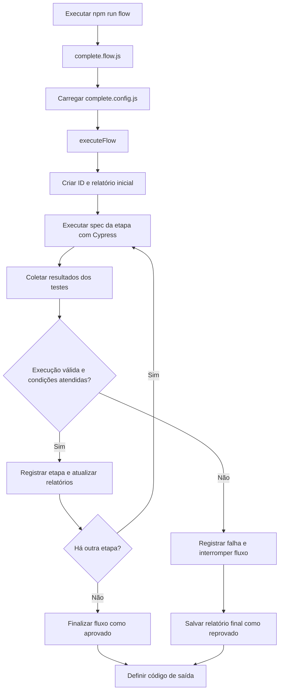

# Flow Engine

## 1. Objetivo

O `flow-engine` é o mecanismo Node.js responsável por orquestrar a execução sequencial de um conjunto de specs do Cypress. Além de iniciar cada spec, ele avalia condições obrigatórias definidas na configuração do fluxo, consolida os resultados dos testes e atualiza relatórios HTML e JSON.

A implementação está localizada em `cypress/flows/engine/flow-engine.js`. O fluxo completo é iniciado por `cypress/flows/complete/complete.flow.js`, usando a configuração de `cypress/flows/config/complete.config.js`.

Este documento descreve o comportamento encontrado nesses arquivos. Não pressupõe que todos os testes de uma etapa precisem passar para que a etapa seja aprovada: a implementação atual avalia as condições explicitamente configuradas.

## 2. Arquivos envolvidos

| Arquivo | Responsabilidade |
|---|---|
| `cypress/flows/engine/flow-engine.js` | Implementa a execução de etapas, a avaliação de condições, a consolidação dos resultados e a geração dos relatórios. |
| `cypress/flows/config/complete.config.js` | Declara o fluxo `complete`, suas etapas, specs e condições obrigatórias. |
| `cypress/flows/complete/complete.flow.js` | Ponto de entrada do fluxo completo; chama `executeFlow()` e define o código de saída do processo. |
| `package.json` | Declara o comando `npm run flow`, que inicia o ponto de entrada do fluxo completo. |

## 3. Visão geral da execução



O diagrama representa o caminho principal. Exceções inesperadas também são capturadas na execução do fluxo, registradas na mensagem do relatório e levam à finalização com status de falha.

## 4. Configuração do fluxo

A configuração `complete.config.js` exporta um objeto `complete` com um nome e uma lista ordenada de etapas. Cada etapa declara:

- `id`: identificador usado nos relatórios e nos diretórios de evidências;
- `name`: nome legível exibido nos logs e relatórios;
- `spec`: caminho do arquivo de teste Cypress executado na etapa;
- `conditions`: lista de resultados obrigatórios para que a etapa seja considerada aprovada.

No fluxo configurado atualmente, a ordem é:

1. `register` — `cypress/e2e/register/register.cy.js`;
2. `login` — `cypress/e2e/login/login.cy.js`;
3. `accounts` — `cypress/e2e/accounts/accounts.cy.js`;
4. `transfer` — `cypress/e2e/transfer/transfer.cy.js`;
5. `billPay` — `cypress/e2e/billpay/billpay.cy.js`;
6. `loan` — `cypress/e2e/loan/loan.cy.js`;
7. `profile` — `cypress/e2e/profile/profile.cy.js`.

Cada etapa contém atualmente uma condição obrigatória: um teste específico deve existir nos resultados e ter estado `passed`. A configuração é, portanto, parte essencial da regra que determina o avanço do fluxo.

### Exemplo de condição

```js
conditions: [
    {
        test: 'TRANSFER001 - deve realizar uma transferência entre contas diferentes',
        expected: 'passed'
    }
]
```

O mecanismo procura um teste cujo título seja igual ao texto configurado ou termine com esse texto. Se o teste não for encontrado, ou se seu estado for diferente de `expected`, a condição é reprovada.

## 5. Ciclo de vida de uma etapa

A função `executeStep(step, flowId)` executa as seguintes operações:

1. Registra o início da etapa e apresenta seu nome e ID no console.
2. Define diretórios próprios para screenshots e vídeos, identificados pelo ID da execução e pelo ID da etapa.
3. Executa o spec usando `cypress.run()`.
4. Coleta os resultados disponíveis, incluindo título, estado, duração, mensagem de erro e, quando associada, uma screenshot.
5. Calcula os totais de testes aprovados, reprovados, pendentes e ignorados.
6. Verifica se houve erro na execução do Cypress, ausência de resultados ou ausência de testes encontrados.
7. Avalia as condições obrigatórias da etapa.
8. Retorna o resultado da etapa e os detalhes dos testes para consolidação pelo fluxo.

### Condições de aprovação

Uma etapa é marcada como `passed` quando não há erro de execução, nenhuma condição obrigatória falha e pelo menos um teste foi coletado.

**Importante:** a implementação registra falhas em testes que não fazem parte das condições obrigatórias, mas elas não reprovam a etapa por si só se todas as condições configuradas forem atendidas. Por isso, o status da etapa não deve ser interpretado isoladamente como “todos os testes dessa spec passaram”. Para avaliar a suíte inteira, consulte também os totais de testes no relatório.

Se uma condição falhar ou ocorrer um erro de execução, a etapa recebe status `failed` e o fluxo é interrompido; as etapas posteriores não são executadas naquela execução.

## 6. Coleta e consolidação dos resultados

A função `collectTests()` percorre os resultados retornados pelo Cypress e cria registros com estes campos:

| Campo | Significado |
|---|---|
| `step` / `stepId` | Nome e ID da etapa em que o teste foi executado. |
| `spec` | Caminho relativo da spec, quando informado pelo Cypress, ou o caminho configurado na etapa. |
| `title` | Título do teste, composto a partir dos títulos retornados pelo Cypress. |
| `state` | Estado retornado para o teste, como `passed`, `failed` ou `skipped`. |
| `durationMs` | Duração em milissegundos, priorizando a duração da última tentativa disponível. |
| `error` | Mensagem de erro da última tentativa ou erro apresentado pelo Cypress, quando existente. |
| `screenshot` | Caminho da screenshot associada, quando localizada para um teste reprovado. |

A função `summarizeTests()` contabiliza os testes por estado. Estados `passed`, `failed` e `skipped` têm contadores próprios; outros estados são contabilizados como `pending`.

### Associação de screenshots

Para testes reprovados, o código procura uma screenshot entre os artefatos do resultado da spec. A busca considera a marca `testFailure` ou a presença do título do teste no nome/caminho da screenshot.

Essa associação é uma heurística da implementação atual e não deve ser tratada como garantia de correspondência exata em todos os cenários com múltiplas falhas. Caso o relatório associe uma evidência incorreta, a lógica de identificação deverá ser aprimorada e validada com execuções que contenham mais de uma falha.

## 7. Identificação e armazenamento dos relatórios

Cada execução recebe um identificador com data e horário, no formato aproximado:

```text
flow-DD-MM-AAAA_HH-mm-ss-mmm
```

Os relatórios são gravados nos seguintes caminhos, relativos à raiz do projeto:

```text
cypress/reports/
├── latest-report.html
├── latest-report.json
└── history/
    └── <flowId>/
        ├── report.html
        └── report.json
```

O diretório exclusivo da execução também é usado como base para as evidências de cada etapa:

```text
cypress/evidence flow/<flowId>/<stepId>/photos/
cypress/evidence flow/<flowId>/<stepId>/videos/
```

A configuração passada a `cypress.run()` define esses diretórios e usa `trashAssetsBeforeRuns: false` para as execuções iniciadas pelo motor. Isso preserva os artefatos dessas etapas conforme o comportamento configurado no Cypress.

### Atualização dos relatórios

O motor grava um relatório inicial com status `running`, atualiza os arquivos após cada etapa concluída e grava novamente ao finalizar. Os arquivos `latest-report.html` e `latest-report.json` representam a execução mais recente; a pasta `history/<flowId>/` preserva uma cópia específica de cada execução.

O relatório HTML apresenta o resumo geral, os dados da execução, os resultados individuais dos testes e uma tabela de etapas. O JSON contém os dados estruturados usados para compor esse relatório.

## 8. Status e código de saída

O fluxo termina com status `passed` quando todas as etapas configuradas são concluídas com sucesso segundo suas condições. Caso uma etapa falhe ou ocorra uma exceção, o status final é `failed`.

O arquivo `complete.flow.js` converte esse resultado em `process.exitCode`: `0` para fluxo aprovado e `1` para fluxo reprovado. Erros inesperados no ponto de entrada também são registrados no console e resultam em código de saída `1`.

Esse código de saída permite que ferramentas externas, scripts ou uma futura pipeline de CI identifiquem se o fluxo foi aprovado. A presença desse mecanismo, por si só, não significa que uma pipeline de CI já esteja configurada.

## 9. Como executar

Na raiz do projeto, com as dependências instaladas e a aplicação acessível no endereço configurado no Cypress:

```bash
npm run flow
```

O comando chama `node cypress/flows/complete/complete.flow.js`, que carrega a configuração do fluxo e inicia a execução sequencial.

Para executar uma spec isolada, consulte os comandos disponíveis em `package.json` e o guia de execução do projeto. A execução direta de uma spec pelo Cypress não equivale à execução orquestrada pelo `flow-engine`: ela não aplica automaticamente a sequência e as condições definidas em `complete.config.js`.

## 10. Limitações e cuidados de manutenção

- As condições obrigatórias estão codificadas em `complete.config.js`; ao renomear um teste, revise a condição correspondente.
- A aprovação de uma etapa não implica necessariamente aprovação de todos os testes da spec, pois apenas as condições declaradas determinam o avanço.
- A seleção de screenshots é heurística e deve ser conferida em execuções com múltiplas falhas.
- A sequência das etapas é definida pela ordem do array `steps`; alterar essa ordem muda a ordem de execução.
- A execução depende de a aplicação estar acessível e de os dados necessários poderem ser preparados pelos próprios testes.
- Os diretórios `latest-report.*` são sobrescritos a cada execução; para comparar execuções, use os arquivos em `history/<flowId>/`.
- A documentação deve ser atualizada sempre que mudarem a estrutura de configuração, os campos do relatório, as regras de avanço ou os diretórios de saída.

## 11. Checklist para alterações no motor

Antes de concluir uma alteração no `flow-engine`, valide:

- [ ] O fluxo continua iniciando pelo comando documentado.
- [ ] Uma etapa aprovada permite que a próxima etapa seja executada.
- [ ] Uma condição obrigatória ausente ou reprovada interrompe o fluxo.
- [ ] Erros de execução são diferenciados de falhas individuais de teste.
- [ ] O relatório é atualizado após cada etapa e ao final da execução.
- [ ] Os relatórios HTML e JSON contêm os mesmos resultados essenciais.
- [ ] As evidências apontam para os testes corretos em uma execução com múltiplas falhas.
- [ ] O código de saída do processo corresponde ao resultado final do fluxo.
