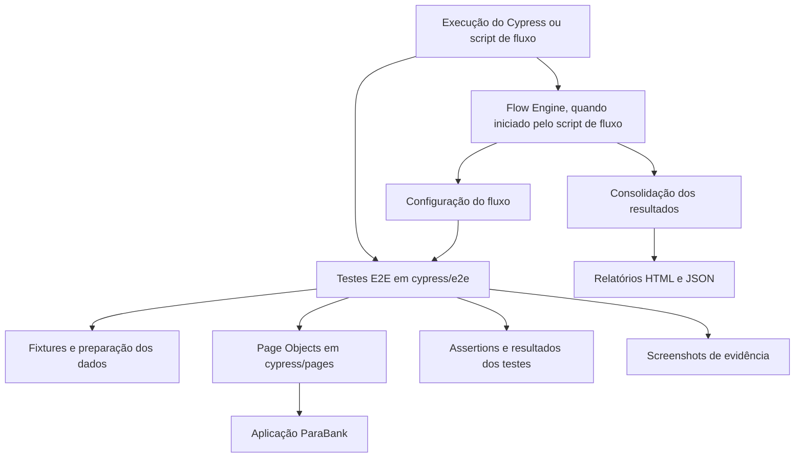

# Visão Geral da Arquitetura

## 1. Objetivo

Este documento apresenta a organização técnica da automação de testes End-to-End do projeto `QA-automation-cypress`. Seu propósito é explicar os principais componentes, suas responsabilidades e a relação entre os testes funcionais, a camada de interação com a aplicação e o mecanismo de execução de fluxos.

A documentação deve refletir a implementação existente no repositório. Detalhes operacionais, convenções de escrita dos testes e funcionamento interno dos relatórios são tratados em documentos específicos.

## 2. Contexto da automação

O projeto utiliza **Cypress** e **JavaScript** para automatizar jornadas funcionais da aplicação bancária de demonstração **ParaBank**. A configuração atual do Cypress define a URL-base como `http://localhost:8080/parabank`, portanto a execução pressupõe que uma instância do ParaBank esteja disponível nesse endereço, salvo alteração explícita da configuração.

A suíte está organizada por áreas funcionais:

- Cadastro de usuário;
- Login e logout;
- Consulta de contas e transações;
- Transferências;
- Pagamento de contas;
- Solicitação de empréstimos;
- Atualização de perfil.

Os testes validam comportamentos da interface e utilizam identificadores nos títulos dos casos, como `REGISTER001`, `LOGIN001` e `TRANSFER001`, para facilitar sua identificação nos resultados de execução.

## 3. Visão de componentes



O diagrama apresenta a separação conceitual entre os componentes. A execução direta do Cypress e a execução pelo mecanismo de fluxo são formas distintas de iniciar os testes; o mecanismo de fluxo executa as specs configuradas em etapas e avalia condições definidas para essas etapas.

## 4. Componentes e responsabilidades

### 4.1. Testes E2E — `cypress/e2e/`

Contêm os cenários automatizados, agrupados por funcionalidade. Cada arquivo `*.cy.js` define os casos de teste, a preparação necessária para o cenário, as ações realizadas e as verificações do resultado esperado.

Estrutura identificada no projeto:

```text
cypress/e2e/
├── accounts/accounts.cy.js
├── billpay/billpay.cy.js
├── loan/loan.cy.js
├── login/login.cy.js
├── profile/profile.cy.js
├── register/register.cy.js
└── transfer/transfer.cy.js
```

### 4.2. Page Objects — `cypress/pages/`

Os Page Objects encapsulam parte dos seletores e das interações com as páginas da aplicação. Essa camada reduz a duplicação e oferece pontos centralizados para manutenção da interação com a interface.

As classes presentes são:

- `HomePage.js`
- `RegisterPage.js`
- `LoginPage.js`
- `AccountsPage.js`
- `TransferPage.js`
- `BillPayPage.js`
- `LoanPage.js`
- `ProfilePage.js`

A utilização do padrão não elimina necessariamente toda interação direta nos arquivos de teste. Ao modificar a suíte, deve-se manter a separação entre ações reutilizáveis da interface e a descrição do cenário de teste.

### 4.3. Fixtures — `cypress/fixtures/`

O projeto contém a fixture versionada `registration.json`, usada como fonte de dados de cadastro e/ou autenticação nos cenários que a carregam. A fixture é um arquivo de dados-base; ela não deve ser confundida com dados criados dinamicamente durante a execução da aplicação.

A forma exata como cada spec prepara usuários e contas deve ser consultada no próprio teste e na implementação dos comandos auxiliares. Não se deve presumir a existência de arquivos persistentes de usuários ou contas que não estejam presentes no código atual.

### 4.4. Support e comandos — `cypress/support/`

O diretório contém `e2e.js`, carregado como arquivo de suporte do Cypress, e `commands.js`, destinado à definição de comandos personalizados. Esses arquivos complementam a configuração global e podem fornecer comportamentos compartilhados pelos testes.

### 4.5. Configuração — `cypress.config.js`

Define a configuração E2E do Cypress, incluindo a URL-base, os tempos limite de comandos, carregamento de página e requisições, além da captura de screenshots em falhas. A gravação de vídeo está desabilitada na configuração atual (`video: false`).

A configuração também define `trashAssetsBeforeRuns: true`; portanto, apesar do comentário existente no arquivo, o Cypress está configurado para limpar os artefatos gerenciados antes das execuções. A retenção de histórico do mecanismo de fluxo é tratada separadamente.

### 4.6. Mecanismo de fluxo — `cypress/flows/`

O projeto possui um mecanismo próprio para executar uma sequência de specs e consolidar seus resultados. O ponto de entrada atual é `cypress/flows/complete/complete.flow.js`, que chama `executeFlow` do `flow-engine.js` usando a configuração definida em `cypress/flows/config/complete.config.js`.

A configuração `complete` define as etapas de cadastro, login, contas, transferências, pagamento de contas, empréstimos e perfil. Cada etapa indica a spec a executar e uma ou mais condições de resultado esperadas. O código de entrada encerra o processo com código de saída compatível com o resultado geral informado pelo mecanismo.

Esse mecanismo é uma camada adicional à execução nativa do Cypress: ele coordena etapas, verifica condições configuradas e reúne os resultados. Seu comportamento detalhado, inclusive as regras para continuar ou interromper o fluxo, deve ser descrito em `flow-engine.md`.

### 4.7. Relatórios e evidências

O código do mecanismo de fluxo utiliza `cypress/reports/` como diretório de relatórios e `cypress/reports/history/` para o histórico de execuções. O mecanismo gera relatórios consolidados em HTML e JSON, com identificador próprio para cada execução.

Os testes também podem produzir screenshots. A configuração do Cypress ativa a captura automática em falhas, e os testes incluem capturas explícitas em etapas selecionadas. O diretório `cypress/evidence flow/` aparece na estrutura do projeto como área de evidências associadas aos fluxos.

Os caminhos, regras de associação das imagens aos casos e campos dos relatórios devem ser detalhados em `reporting.md`, sem presumir que toda falha sempre terá uma screenshot correspondente.

## 5. Formas de execução

O `package.json` declara os seguintes scripts principais:

| Comando | Finalidade |
|---|---|
| `npm run cy:open` | Abre a interface interativa do Cypress. |
| `npm run cy:run` | Executa a suíte em modo não interativo. |
| `npm run cy:chrome` | Executa o Cypress usando o navegador Chrome. |
| `npm test` | Executa `cypress run`. |
| `npm run flow` | Inicia o fluxo completo configurado em `complete.flow.js`. |
| `npm run flow:register` | Executa a spec de cadastro. |
| `npm run flow:login` | Executa a spec de login. |
| `npm run flow:accounts` | Executa a spec de contas. |
| `npm run flow:transfer` | Executa a spec de transferências. |

Esses scripts são os declarados no `package.json` analisado. A lista não implica que existam scripts individuais para todas as funcionalidades.

## 6. Fluxo geral de execução

Em uma execução direta, o Cypress carrega sua configuração e os arquivos de suporte, descobre a spec selecionada e executa os casos de teste. Os cenários preparam os dados necessários, interagem com a aplicação por meio dos Page Objects e/ou de comandos do Cypress e verificam os resultados com assertions.

Quando a execução é iniciada por `npm run flow`, o mecanismo lê a configuração do fluxo, executa as specs em sequência e compara os resultados com as condições declaradas para cada etapa. Ao final, consolida os resultados e informa o sucesso ou a falha do processo por meio do código de saída.

## 7. Limites do escopo atual

Esta arquitetura documenta a automação E2E presente no repositório. A presença de Cypress, Page Objects, relatórios ou execução por etapas não comprova, por si só, cobertura completa da aplicação, ausência de flakiness, execução em integração contínua ou testes de desempenho e segurança.

Esses aspectos só devem ser documentados como capacidades existentes quando houver implementação e evidências verificáveis no projeto.

## 8. Documentação relacionada

- [`project-structure.md`](project-structure.md) — organização dos diretórios e arquivos;
- [`page-object-model.md`](page-object-model.md) — responsabilidades e convenções dos Page Objects;
- [`flow-engine.md`](flow-engine.md) — funcionamento do mecanismo de execução de fluxos;
- [`reporting.md`](reporting.md) — relatórios, histórico e evidências;
- [`../testing/test-strategy.md`](../testing/test-strategy.md) — estratégia e escopo dos testes;
- [`../testing/test-catalog.md`](../testing/test-catalog.md) — catálogo dos casos automatizados;
- [`../testing/test-data.md`](../testing/test-data.md) — preparação e gerenciamento dos dados de teste;
- [`../guides/execution.md`](../guides/execution.md) — instruções de execução.

> **Nota de manutenção:** confirme os caminhos dos documentos relacionados quando a nova estrutura de `docs/` for criada. Este arquivo descreve os componentes observados no pacote analisado; alterações futuras na implementação devem ser refletidas aqui.
